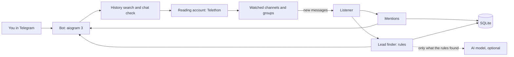

# Shillometer

A Telegram bot that watches Telegram channels and groups. It has two modules, and you choose which to run:

- **Mentions** (the Shillometer): searches the channels' recent history for a project on request and sends an alert as soon as a new post mentions a watched project.
- **Lead finder**: notices people who ask for what you offer, describe a problem you can fix or hire for it, and tells you. The bot never answers anyone: you decide and reply from your own account.

Built in June 2025 to measure how widely crypto projects were promoted ("shilled") across Telegram channels. The lead finder was added in November 2026 on the same engine.

## What it does

### Mentions

- **History search** (`/analyze`, open to anyone). Send a project name and pick a period. The bot reads every watched channel for that period and replies with how many posts it checked, how many mention the project and in which channels, with a link to every post.
- **Live alerts** (admins). Admins keep a list of projects. When a new post in a watched channel mentions one, the admins get the post's opening lines and a link to it.

### Lead finder

- **Niches.** A niche is a topic with the words people use for it: "Websites and SEO" with `сайт*`, `SEO`, `Next.js`; "Repair" with `ремонт*`, `сантехник*`. It works for any trade.
- **Three kinds of leads.** A request ("нужен сайт", "looking for an SEO specialist"), a problem ("сайт не открывается", "our website is broken") and a vacancy ("ищем Next.js-разработчика в штат"). People offering their own services or looking for work are left out.
- **Alerts.** Each alert names the kind, the niche, the chat and the author, quotes the message and links to it and, when the author has a username, to the author. Two buttons, "I'll reply" and "Not a lead", record what you made of it. The same text posted in several chats alerts once a day.
- **Check a chat first** (`/check_chat @chat [days]`). Reads the last 7 days, or up to 30, without joining, and shows how many requests, problems and vacancies your niches would have caught, with examples. It shows whether a chat is worth adding before the reading account joins it.
- **Settings** (`/lead_settings`). Turn each kind on or off: problems are the noisiest kind in professional chats, where colleagues ask each other.
- **Statistics** (`/lead_stats`). Per chat for 30 days: alerts, "I'll reply", "Not a lead", unmarked. It shows which chats bring leads and which only make noise.
- **Optional AI check.** With an API key, a model reads only the messages the rules found and notes who writes (a client, a colleague, a seller, a job seeker) and what they need. In the labels mode every lead still comes, with the note; in the filter mode only what the model confirms comes.

Both modules share the list of watched channels and groups, which admins edit with bot commands; no restart is needed.

## How matching works

Words match whole, in any case: `ton` finds "TON is up" but not "button". A word ending in `*` matches every word that starts with it: `сайт*` finds "сайт", "сайта" and "сайтом", which covers the forms of a Russian word.

A message is a lead when it has a word of one of your niches, a phrase of one of the kinds ("ищу", "нужен", "кто сделает", "looking for", "не работает", "вакансия", "hiring"...) and none of the exclusions ("#резюме", "ищу работу", "наша студия", "#помогу"...). Job board hashtags such as `#вакансия` and `#ищу` decide the kind outright. A message with phrases of two kinds gets the first of request, vacancy, problem. The phrases are in `core/leads/phrases.py`; `tests/lead_corpus.py` holds invented sample messages with the answer the rules must give.

## How it works



One process runs two Telegram clients. The bot is the interface you talk to. A regular Telegram account, the reading account, reads the chats through the official API, because a bot cannot read channel history or get messages from chats where it is not an admin. One listener hands every new message to the enabled modules; a module that fails does not stop the other. The lead rules need no database and no network, so most messages are dropped before anything else runs.

## Keeping the reading account safe

The reading account is a real Telegram account, so the bot treats it with care:

- **It never writes.** The bot does not post, reply or message anyone from the reading account. Alerts go to you, and you answer from your own account.
- **It asks before joining.** Telegram sends new messages only to members, so live alerts need the account to be in a chat. The bot never joins on its own: at startup it lists the chats the account is not in and asks the admins, and `/add_channel` asks about each new one. After an admin says yes, it joins one chat a minute and reports each join. After joining a group it reminds you to pass the "I'm not a bot" check many groups ask for, and a chat that admits members by request gets a request.
- **It respects Telegram's limits.** Telegram publishes no numbers for them. A flood wait is waited out, not retried, and joining stops at the limit of about 500 chats.
- **It never leaves a chat.** Removing a chat from the list keeps the account in it, so the bot cannot unsubscribe the owner from chats they read.
- **Searches are rationed.** Anyone can search three times a day over up to 30 days; admins have no limit and can go back 180 days. One search or chat check runs at a time, with pauses between chats. The search reads channels and groups only, never the account's private chats.
- **Rights are checked on every step.** Every admin command, dialog step and button checks the sender, because anyone can send a bot any button data. Niches, settings and leads belong to the user who made them, and only that user can change them.
- **The session stays local.** The session file gives full access to the account. It is kept out of git, and the session can be ended in Telegram under Settings, Devices. If you run the bot on a server, use a separate Telegram account for reading.

## What people wrote

The lead finder stores the messages it alerts about, so it handles them carefully:

- After 30 days a lead keeps only its kind, chat, date and your answer: the text, the author and the links are erased at startup and once a day.
- With the AI check on, the messages the rules found, never the others, go to the model's provider, cut to 1500 characters. On OpenRouter, turn off providers that may train on your data and turn on zero data retention in the privacy settings.
- Logs name what failed, never the text of a message or the API key.
- At most 300 AI checks a day per user, so a broken rule cannot run up a bill. A failed check never loses a lead: the alert comes by the rules, with a note.

## Run it yourself

You need Python 3.10 or newer, a Telegram account to read the chats and a bot token.

1. Create a bot with [@BotFather](https://t.me/BotFather) and copy its token.
2. Sign in at [my.telegram.org](https://my.telegram.org) with the reading account, open "API development tools" and create an app to get `api_id` and `api_hash`.
3. Find your own Telegram user ID, for example with [@userinfobot](https://t.me/userinfobot). Admins are listed by these IDs.
4. Install and configure:

   ```bash
   git clone https://github.com/ant4x/shillometer.git
   cd shillometer
   python -m venv .venv
   source .venv/bin/activate          # Windows: .venv\Scripts\Activate.ps1
   pip install -r requirements.txt
   cp .env.example .env               # then fill in the values below
   ```

   | Variable | Needed | What it is |
   |---|---|---|
   | `TOKEN` | yes | The bot token from BotFather |
   | `ADMINS_ID` | yes | Admins' Telegram user IDs, separated by commas |
   | `API_ID`, `API_HASH` | yes | The reading account's app from my.telegram.org |
   | `MODULES` | no | `mentions`, `leads` or `mentions,leads`; `mentions` when empty |
   | `AI_API_KEY` | no | A key for an OpenAI-compatible API, for the AI check of leads |
   | `AI_MODEL` | no | The model to use, for example one from [OpenRouter's list](https://openrouter.ai/models) |
   | `AI_BASE_URL` | no | The API address; `https://openrouter.ai/api/v1` when empty |

5. Run `python main.py`. At the first prompt, enter the reading account's **phone number**, not the bot token. The login code arrives in the Telegram app, in the chat with "Telegram", not by SMS. Telegram may then ask the account to confirm the new login.
6. Open your bot in Telegram and send `/start`. The chat list starts empty: add channels and groups with `/add_channel`, and the bot asks before the reading account joins any of them. For leads, add a niche with `/add_niche` and try `/check_chat` on a chat first.

## Commands

| Command | Who | Module | What it does |
|---|---|---|---|
| `/start` | anyone | both | Lists the commands |
| `/cancel` | anyone | both | Stops the current step |
| `/add_channel`, `/del_channel`, `/list_channels` | admins | both | Manage the watched channels and groups |
| `/analyze` | anyone | mentions | Searches past posts for a project |
| `/add_project`, `/del_project`, `/list_projects` | admins | mentions | Manage the projects for live alerts |
| `/add_niche`, `/del_niche`, `/list_niches` | admins | leads | Manage your niches and their words |
| `/lead_settings` | admins | leads | Choose the kinds of leads and the AI mode |
| `/check_chat` | admins | leads | Checks a chat's recent history for leads |
| `/lead_stats` | admins | leads | Lead statistics per chat for 30 days |

## Tests

```bash
python -m unittest discover -s tests -t .
```

129 tests cover the parts that do not need Telegram: keyword matching, the lead rules on a corpus of sample messages, alerts and their escaping, repeated texts, the 30-day erasing, niches, settings and statistics on a fresh database, the AI answer parsing with its failures and daily cap, the chat check, the history search, the daily search limit, the startup check of the chat list and the joining logic. Fakes stand in for Telegram and the AI.

## Limits

- Matching is by words, not meaning; other forms of a word need `*`. The AI check helps with meaning but is optional.
- Live alerts come only from chats the reading account is in. Basic (small, old-style) groups and private chats joined by invite link are not supported.
- A link to a message in a chat without a public username opens only for its members.
- Edited messages are not checked again.
- Search results and the daily counters are kept in memory until the bot restarts, and one search runs at a time.
- SQLite and a single process make it a tool for a small team, not a public service.

## Stack

Python 3.10+, aiogram 3, Telethon 1.40, aiosqlite, aiohttp, environs, unittest.

## History

The first commit is the June 2025 version as it ran, without the list of channels it watched. The commits after it, from November 2026, review and fix that code, then add the lead finder step by step; each one says what changed and why.

## License

[MIT](LICENSE)

## Author

Anthony Fox, [stratosly.com](https://stratosly.com).
