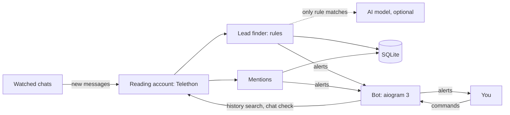

# Telegram Lead Finder

[](https://github.com/ant4x/telegram-lead-finder/actions/workflows/tests.yml)

The bot reads the Telegram chats you choose and tells you when someone asks for what you offer, or when a project you follow is mentioned. It reads through a regular Telegram account, the reading account, and never writes to anyone: you decide and reply from your own account. Two modules, run either or both:

- **Lead finder**: notices people who ask for what you offer, describe a problem you can fix or hire for it, and sends you an alert.
- **Mentions** (the original Shillometer): searches the chats' recent history for a project on request and alerts you as soon as a new post mentions a watched project.

It began in June 2025 as the Shillometer, to measure the share of voice of crypto projects across Telegram channels: how many channels promoted ("shilled") each one. The lead finder was added in November 2026 on the same engine. Here a chat means a channel or a group.

A lead alert as it arrives in the bot's chat (the message and the names are invented):

```text
Lead · Websites and SEO · Request
Chat: Freelance orders
From: @maria_yoga

"Looking for a Next.js developer to rebuild our yoga studio website, budget around $1500."
AI: client · a new website for a yoga studio, about $1500

Open the message · Message the author
[ I'll reply ]  [ Not a lead ]
```

## What it does

### Lead finder

- **Niches.** A niche is a topic with the words people use for it: "Websites and SEO" with `сайт*` (website), `website*`, `SEO`, `Next.js`; "Repair" with `ремонт*` (repair), `сантехник*` (plumber). It works for any trade, in Russian and English.
- **Three kinds of leads.** A request (someone asks for what you do), a problem (someone has a problem you can fix) and a vacancy (a company hires for it); the table under [How matching works](#how-matching-works) shows typical phrases. Messages from people selling their own services or looking for work are ruled out. The rules catch words, not intent, so some ads still come through; the AI check is there for those.
- **Alerts.** Each alert names the kind, the niche, the chat and the author, quotes the message and links to it and, when the author has a username, to the author. Two buttons, "I'll reply" and "Not a lead", record what you made of it. The same text posted in several chats alerts once a day.
- **Check a chat first** (`/check_chat @chat [days]`). Reads the last 7 days, or up to 30, without joining and by the rules alone, and shows how many requests, problems and vacancies your niches would have caught, with up to 5 links. It shows whether a chat is worth adding before the reading account joins it.
- **Settings** (`/lead_settings`). Turn each kind on or off and pick the AI mode. Problems are the noisiest kind in professional chats, where colleagues ask each other.
- **Statistics** (`/lead_stats`). Per chat for 30 days: alerts, "I'll reply", "Not a lead", unmarked and, with the AI filter, how many it held back. It shows which chats bring leads and which only make noise.
- **Optional AI check.** With `AI_API_KEY` and `AI_MODEL` set, a model reads only the messages the rules found and notes who writes (a client, a colleague, a seller, a job seeker) and what they need. Labels is the default mode: every lead still comes, with the note. In the filter mode only what the model confirms comes; `/lead_settings` switches modes or turns the check off.

### Mentions

- **History search** (`/analyze`, open to anyone). Send a project name and pick a period. The bot reads every watched chat for that period and replies with how many posts it checked, how many mention the project and in which chats, with a link to every post.
- **Live alerts** (admins). Admins keep a list of projects. When a new post in a watched chat mentions one, the admins get the post's opening lines and a link to it.

Both modules share the list of watched channels and groups, which admins edit with bot commands; no restart is needed.

## How matching works

Words match whole, in any case: `ton` finds "TON is up" but not "button". A word ending in `*` matches every word that starts with it: `сайт*` finds "сайт", "сайта" and "сайтом", which covers the forms of a Russian word.

A message is a lead when it has a word of one of your niches, a phrase of one of the kinds and none of the exclusions:

| Kind | English phrases | Russian phrases |
|---|---|---|
| Request | looking for, need a, who can | ищу (looking for), нужен (need), кто сделает (who will make), подрядчик (contractor) |
| Problem | doesn't work, broken, error | не работает (doesn't work), не открывается (won't open), ошибка (error) |
| Vacancy | hiring, salary, full-time | вакансия (vacancy), в штат (on staff), ищем (we're looking for) |
| Ruled out | looking for a job, open to work, #resume | ищу работу (looking for a job), наша студия (our studio), #помогу (I can help) |

The words of a phrase may be split by a line break. Job board hashtags such as `#вакансия` and `#ищу` decide the kind outright. A message with phrases of two kinds gets the first of request, vacancy, problem, so "ищем подрядчика" (looking for a contractor) is an order, not a job. The full lists are in `core/leads/phrases.py`; `tests/lead_corpus.py` holds invented sample messages with the answer the rules must give.

## How it works



One process runs two Telegram clients. The bot is the interface you talk to. A regular Telegram account, the reading account, reads the chats through the official API, because a bot cannot read history and sees a chat only after the chat adds it, while an account can join any public chat. One listener hands every new message to the enabled modules; a module that fails does not stop the other. The lead rules need no database and no network, so most messages are dropped before anything else runs.

## Keeping the reading account safe

The reading account is a real Telegram account, so the bot treats it with care:

- **It never writes.** The bot does not post, reply or message anyone from the reading account. Alerts go to you, and you answer from your own account.
- **It asks before joining.** Telegram sends new messages only to members, so live alerts need the account to be in a chat. The bot never joins on its own: at startup it lists the chats the account is not in and asks the admins, and `/add_channel` asks about each new one. After an admin says yes, it joins one chat a minute and reports each join. After joining a group it reminds you to pass the "I'm not a bot" check many groups ask for, and a chat that admits members by request gets a request.
- **It respects Telegram's limits.** Telegram publishes no numbers for them. Pauses of up to a minute are waited out on the spot; on a longer one joining waits the whole pause and tries again, and a search skips the chat. Chats are looked up in the session's cache, so usernames are not resolved again and again, and joining stops at Telegram's cap of about 500 chats.
- **It never leaves a chat.** Removing a chat from the list keeps the account in it, so the bot cannot unsubscribe the owner from chats they read.
- **Searches are rationed.** Anyone can search three times a day over up to 30 days; admins have no limit and can go back 180 days. One search or chat check runs at a time, with pauses between chats. The search reads channels and groups only, never the account's personal conversations.
- **Rights are checked on every step.** Every admin command, dialog step and button checks the sender, because anyone can send a bot any button data. Niches, settings and leads belong to the user who made them, and only that user can change them.
- **The session stays local.** The session file gives full access to the account. It is kept out of git, and the session can be ended in Telegram under Settings, Devices. Use a separate account for reading, and on a server always; you still answer leads from your own.

## What people wrote

The bot stores what it finds, so it handles it carefully:

- The lead finder saves every lead the rules find, alerted or held back by the AI filter. After 30 days a lead keeps only its kind, chat, date, your answer and the AI's guess of who wrote it (a client, a colleague...): the text, the author, the summary and the links are erased and overwritten in the database file, at startup and once a day.
- The mentions module keeps the text and link of every post that names a watched project, with no time limit. Removing a chat deletes its posts and leads.
- With the AI check on, the provider gets the text of each message the rules found (cut to 1500 characters), your niches' names and words, and the kind the rules picked; never the author, the chat or other messages. On OpenRouter, turn off providers that may train on your data and turn on zero data retention in the privacy settings.
- Logs name what failed, never the text of a message or the API key.
- At most 300 AI checks a day per admin, so a broken rule cannot run up a bill. A failed check never loses a lead: the alert comes by the rules, with a note.

## Run it yourself

You need Python 3.10 or newer, a Telegram account to read the chats and a bot token.

1. Create a bot with [@BotFather](https://t.me/BotFather) and copy its token.
2. Sign in at [my.telegram.org](https://my.telegram.org) with the reading account, open "API development tools" and create an app to get `api_id` and `api_hash`.
3. Find your own Telegram user ID, for example with [@userinfobot](https://t.me/userinfobot). Admins are listed by these IDs.
4. Install and configure:

   ```bash
   git clone https://github.com/ant4x/telegram-lead-finder.git
   cd telegram-lead-finder
   python -m venv .venv
   source .venv/bin/activate          # Windows: .venv\Scripts\Activate.ps1
   pip install -r requirements.txt
   cp .env.example .env               # then fill in the values below
   ```

   | Variable | Needed | What it is |
   |---|---|---|
   | `TOKEN` | yes | The bot token from BotFather |
   | `ADMINS_ID` | yes | Admins' Telegram user IDs, separated by commas |
   | `API_ID`, `API_HASH` | yes | The reading account's app from my.telegram.org |
   | `MODULES` | no | `mentions`, `leads` or `mentions,leads`; `mentions` when empty |
   | `AI_API_KEY` | for the AI check | A key for an OpenAI-compatible API |
   | `AI_MODEL` | for the AI check | The model to use, for example one from [OpenRouter's list](https://openrouter.ai/models) |
   | `AI_BASE_URL` | no | The API address; `https://openrouter.ai/api/v1` when empty |

5. Run `python main.py`. At the first prompt, enter the reading account's **phone number**, not the bot token. The login code arrives in the Telegram app, in the chat with "Telegram", not by SMS. Telegram may then ask the account to confirm the new login.
6. Open your bot in Telegram and send `/start`. The chat list starts empty: add channels and groups with `/add_channel`, and the bot asks before the reading account joins any of them. For leads, add a niche with `/add_niche` and try `/check_chat` on a chat first.

## Commands

| Command | Who | Module | What it does |
|---|---|---|---|
| `/start` | anyone | both | Lists the commands |
| `/cancel` | anyone | both | Stops the current step |
| `/add_channel`, `/del_channel`, `/list_channels` | admins | both | Manage the watched channels and groups |
| `/analyze` | anyone | mentions | Searches past posts for a project |
| `/add_project`, `/del_project`, `/list_projects` | admins | mentions | Manage the projects for live alerts |
| `/add_niche`, `/del_niche`, `/list_niches` | admins | leads | Manage your niches and their words |
| `/lead_settings` | admins | leads | Choose the kinds of leads and the AI mode |
| `/check_chat` | admins | leads | Checks a chat's recent history for leads |
| `/lead_stats` | admins | leads | Lead statistics per chat for 30 days |

## Tests

```bash
python -m unittest discover -s tests -t .
```

153 tests, with fakes for Telegram and the AI, cover the lead rules on a corpus of sample messages, keyword matching, alerts and their escaping, repeats, the 30-day erasing, the database queries, the AI answers, failures and daily cap, the chat check and the history search, the limits, joining chats and the dialog steps that need no Telegram.

## Limits

- Matching is by words, not meaning; other forms of a word need `*`. The AI check helps with meaning but is optional.
- Live alerts come only from chats the reading account is in. Basic (small, old-style) groups are not supported. The bot cannot join a private chat itself: join it with the reading account first, then add it by its invite link or ID.
- A link to a message in a chat without a public username opens only for its members.
- Edited messages are not checked again.
- Search results and the daily counters are kept in memory until the bot restarts, and one search runs at a time.
- SQLite and a single process make it a tool for a small team, not a public service.

## Stack

Python 3.10+, aiogram 3, Telethon 1.40, aiosqlite, aiohttp, environs, unittest.

## How I built it

The first commit is the June 2025 version as it ran, without the list of channels it watched. The commits after it, from November 2026, review and fix that code, then add the lead finder step by step; each one says what changed and why.

Since November 2026 I have worked on it with Claude Code, an AI coding assistant, and the commits say so:

- **My part:** what the bot is for and the decisions a user feels. Three kinds of leads; rules first and the AI only on what they found; the bot never writes to anyone, and a person replies from their own account; asking before joining any chat; erasing what people wrote after 30 days; a cap of 300 AI checks a day; the labels and filter modes. They were agreed in a design and a task-by-task plan before any code, and I ran the bot on live channels.
- **The assistant's part:** most of the code and the tests, task by task against that plan, each change with a test that failed first.
- **Reviews:** reviewers who had not seen the code read it again after it was written and found what the tests had missed. Two copies of a message arriving at the same moment sent two alerts (`7a5b3b1`); a chat that banned the reading account stopped all joining, and erased leads stayed readable in the database file (both `cccf967`).

## License

[MIT](LICENSE)

## Author

Anthony Fox, [stratosly.com](https://stratosly.com).
