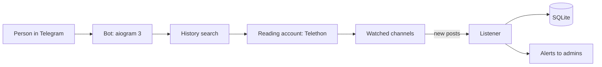

# Shillometer

A Telegram bot that monitors mentions of a project across Telegram channels: it searches their recent history on request and sends an alert as soon as a new post mentions a watched project.

Built in June 2025 to measure how widely crypto projects were promoted ("shilled") across Telegram channels.

## What it does

- **History search** (`/analyze`, open to anyone). Send a project name and pick a period. The bot reads every watched channel for that period and replies with how many posts it checked, how many mention the project and in which channels, with a link to every post.
- **Live alerts** (admins). Admins keep a list of projects. When a new post in a watched channel mentions one, the admins get the post's opening lines and a link to it.
- **Lists in the chat** (admins). Channels and projects are added and removed with bot commands; no restart is needed.

Matching is by whole words, in any case: `ton` finds "TON is up" but not "button". A name ending in `*` matches every word that starts with it: `crypt*` finds "crypto" and "cryptocurrency", which also covers other forms of a Russian word.

## How it works



One process runs two Telegram clients. The bot is the interface people talk to. A regular Telegram account, the reading account, reads the channels through the official API, because a bot cannot read channel history or get posts from channels where it is not an admin. Channel and project lists and the posts that mention a project are kept in SQLite.

## Keeping the reading account safe

The reading account is a real Telegram account, so the bot treats it with care:

- **It asks before joining.** Telegram sends new posts only to channel members, so live alerts need the account to be in a channel. The bot never joins on its own: at startup it lists the channels the account is not in and asks the admins, and `/add_channel` asks about each new channel. After an admin says yes, it joins one channel a minute and reports each join.
- **It respects Telegram's limits.** Telegram publishes no numbers for them. A flood wait is waited out, not retried, and joining stops at the channel limit of about 500.
- **It never leaves a channel.** Removing a channel from the list keeps the account in it, so the bot cannot unsubscribe the owner from channels they read.
- **Searches are rationed.** Anyone can search three times a day over up to 30 days; admins have no limit and can go back 180 days. One search runs at a time, with pauses between channels.
- **Admin rights are checked on every step.** Every admin command, dialog step and button checks the sender, because anyone can send a bot any button data.
- **The session stays local.** The session file gives full access to the account. It is kept out of git, and the session can be ended in Telegram under Settings, Devices. If you run the bot on a server, use a separate Telegram account for reading.

## Run it yourself

You need Python 3.10 or newer, a Telegram account to read the channels and a bot token.

1. Create a bot with [@BotFather](https://t.me/BotFather) and copy its token.
2. Sign in at [my.telegram.org](https://my.telegram.org) with the reading account, open "API development tools" and create an app to get `api_id` and `api_hash`.
3. Find your own Telegram user ID, for example with [@userinfobot](https://t.me/userinfobot). Admins are listed by these IDs.
4. Install and configure:

   ```bash
   git clone https://github.com/ant4x/shillometer.git
   cd shillometer
   python -m venv .venv
   source .venv/bin/activate          # Windows: .venv\Scripts\Activate.ps1
   pip install -r requirements.txt
   cp .env.example .env               # then fill in the four values
   ```

5. Run `python main.py`. At the first prompt, enter the reading account's **phone number**, not the bot token. The login code arrives in the Telegram app, in the chat with "Telegram", not by SMS. Telegram may then ask the account to confirm the new login.
6. Open your bot in Telegram and send `/start`. The channel list starts empty: add channels with `/add_channel`, and the bot asks before the reading account joins any of them.

## Commands

| Command | Who | What it does |
|---|---|---|
| `/start` | anyone | Lists the commands |
| `/analyze` | anyone | Searches past posts for a project |
| `/cancel` | anyone | Stops the current step |
| `/add_channel`, `/del_channel`, `/list_channels` | admins | Manage the watched channels |
| `/add_project`, `/del_project`, `/list_projects` | admins | Manage the projects for live alerts |

## Tests

```bash
python -m unittest discover -s tests -t .
```

38 tests cover the parts that do not need Telegram: keyword matching, quoting and splitting messages, post links, deletes in the database schema, the daily search limit, the startup check of the channel list and the channel joining logic, with fakes in place of Telegram.

## Limits

- Matching is by words, not meaning; other forms of a word need `*`.
- Live alerts come only from channels the reading account is in.
- Search results are kept in memory until the bot restarts, and one search runs at a time.
- SQLite and a single process make it a tool for a small team, not a public service.

## Stack

Python 3.10+, aiogram 3, Telethon 1.40, aiosqlite, environs, unittest.

## History

The first commit is the June 2025 version as it ran, without the list of channels it watched. The commits after it, from November 2026, review and fix that code; each one says what was wrong and why.

## License

[MIT](LICENSE)

## Author

Anthony Fox, [stratosly.com](https://stratosly.com).
